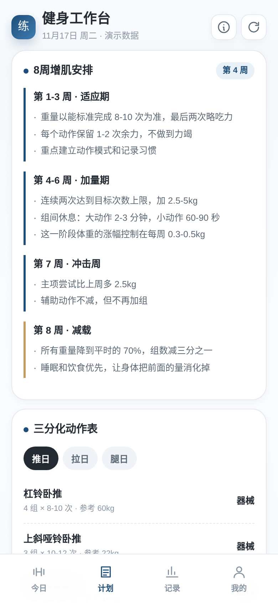
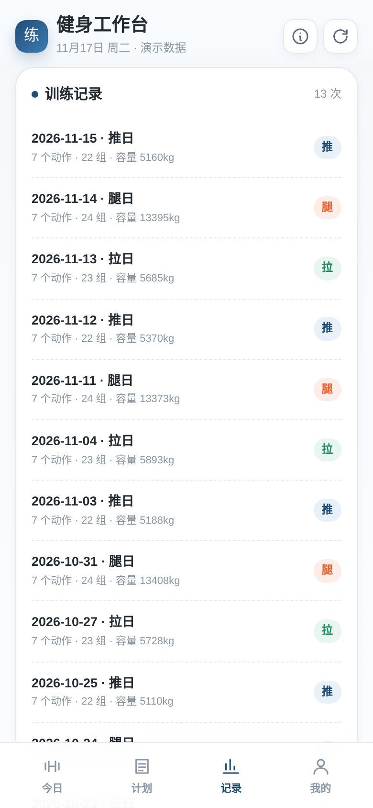

# 健身工作台

三分化推 / 拉 / 腿，先选今天练什么，队列会自己往后顺延。

单文件 HTML，双击就能用，离线可用。





## 为什么先选部位

大多数训练计划死在「今天不想练」这一步：计划写着推日，人没去，第二天又该拉日，一周下来全乱。这个程序把选择放在最前面：推、拉、腿、休息四选一。

- 选推、拉、腿：进入当天训练，填完重量次数点完成，队列往后推一格
- 选休息：只记一条休息，队列不动，明天该练什么还是什么

队列是 `['推','拉','腿']`，当前部位等于已完成训练次数对 3 取模。连着加三天班，回来也不会跳过错过的部位。

## 能做什么

- **今日**：训练状态四选一、身体数据、训练日历（浅蓝推、浅绿拉、浅金腿、米色休息）、动作表、补剂打卡
- **计划**：8 周增肌安排（适应、加量、冲击、减载）、三分化动作表
- **记录**：训练历史、容量、围度、个人纪录 PR
- **我的**：累计训练次数、连续周数、导出与重置

每个部位 7 个动作，都包含悬垂举腿和绳索跪姿卷腹。重量和次数直接点数字改，改完即时保存。

## 怎么用

下载 `fitness-workbench.html`，双击打开。首次生成最近三周约 15 次训练记录，今天是空白的，等你自己选。

## 数据在哪

localStorage，键名 `fitness_wb_v1`。不上传，清缓存会丢，记得导出 JSON。

## 已知限制

- 没有动作示范图和视频，只有文字要点
- 不自动算 1RM，PR 按你填的最好成绩记录
- 容量统计是重量 × 次数 × 组数之和，不区分器械和自由重量
- 训练建议是通用三分化思路，有伤在身请先问医生或教练

## 文件结构

```
fitness-workbench.html   程序本体，40KB
screenshots/             三张界面截图
LICENSE
```

## 许可

MIT，可自由用于个人学习与二次修改，转载或商用请先联系作者。
